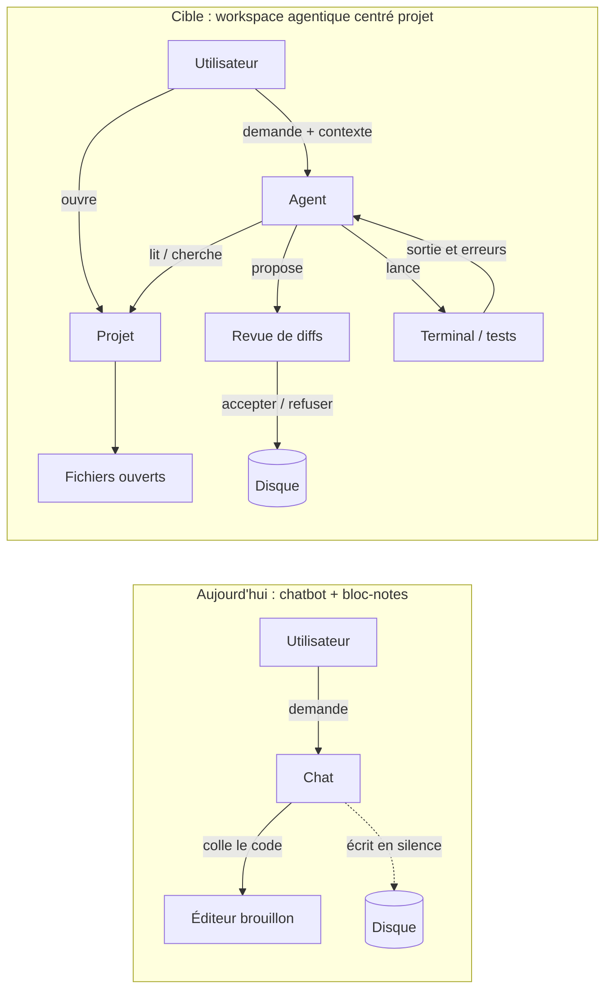
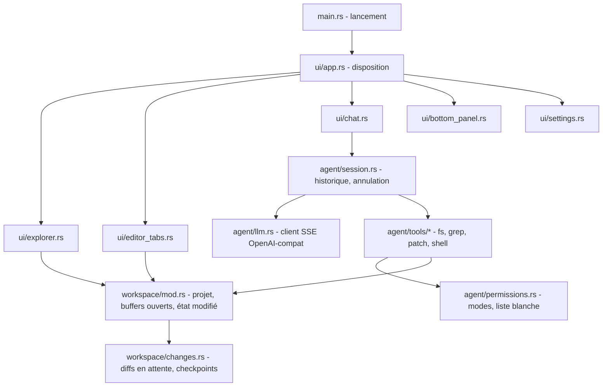

# RustAgent — Revue & axes d'amélioration

## 1. Le constat en une phrase

Aujourd'hui, RustAgent ressemble à **4 outils posés côte à côte qui ne se parlent presque pas** :

| Panneau | Ce qu'il fait réellement | Ce qui manque |
|---|---|---|
| Arborescence | Affiche le dossier courant du terminal | **On ne peut pas ouvrir un fichier** (les fichiers n'ont aucun `on_press`) |
| Éditeur | Un *bloc-notes* qui reçoit le code généré par le chat | Pas d'ouverture de fichier, pas de sauvegarde, un seul fichier, pas lié au disque |
| Terminal | Un vrai PTY | L'agent ne voit ni sa sortie ni ses erreurs |
| Chat | Un agent avec des outils MCP (système de fichiers) | **Aucune mémoire entre deux messages**, il modifie des fichiers sans rien montrer |

L'utilisateur doit donc faire le lien lui-même. Or c'est justement ce lien (ce que l'agent voit, ce qu'il modifie, ce qui s'exécute) qui fait la valeur d'un outil comme celui-ci.

---

## 2. Bugs & dettes à corriger en priorité

> [!CAUTION]
> Ces points causent des comportements faux ou risqués aujourd'hui, avant même de parler de nouvelles fonctionnalités.

| # | Problème | Où | Impact |
|---|---|---|---|
| 1 | **Pas d'historique de conversation** : on n'envoie que `system` + le dernier message `user` | [api.rs `run_agent_loop_stream`](file:///c:/Users/vadzt/Documents/rustagent/src/api.rs#L457-L470) | Une question de suivi comme « corrige ça » ne fonctionne pas : l'agent a tout oublié |
| 2 | **Le serveur MCP est relancé via `npx` à chaque message** | [main.rs L561](file:///c:/Users/vadzt/Documents/rustagent/src/main.rs#L561) | Plusieurs secondes de latence par message, un processus enfant de plus à chaque fois, et ça dépend de Node |
| 3 | **Relance + streaming** : `prompt_with_retry` rejoue toute la boucle dans la même bulle | [main.rs L604-L634](file:///c:/Users/vadzt/Documents/rustagent/src/main.rs#L604-L634) | Le texte apparaît en double et **les outils d'écriture sont exécutés deux fois** |
| 4 | **UTF-8 coupé** : `from_utf8_lossy` est appliqué morceau par morceau du flux | [api.rs L503](file:///c:/Users/vadzt/Documents/rustagent/src/api.rs#L503) | Des `�` apparaissent dans les accents français (é, è, à…) quand un caractère tombe à cheval sur deux morceaux |
| 5 | **Écritures sans validation** : l'agent écrit sur le disque, et le diff part seulement dans `println!` | [api.rs L588-L618](file:///c:/Users/vadzt/Documents/rustagent/src/api.rs#L588-L618) | L'utilisateur ne sait pas ce qui a changé. C'est dangereux |
| 6 | **Racine MCP = `"."`** (le dossier du processus) alors que l'arborescence suit le dossier du terminal | [main.rs L561](file:///c:/Users/vadzt/Documents/rustagent/src/main.rs#L561) | L'agent et l'arborescence peuvent regarder deux dossiers différents |
| 7 | **Détection de langage par mots-clés** : `contains("rs")`, `"js"`, `"c "` | [main.rs `detect`](file:///c:/Users/vadzt/Documents/rustagent/src/main.rs#L181-L207) | « users », « first », « ajs » sont détectés comme du Rust ou du JS : faux positifs fréquents |
| 8 | Le prompt système dit « Ne réponds **jamais** "je ne peux pas" » | [main.rs L618-L622](file:///c:/Users/vadzt/Documents/rustagent/src/main.rs#L618-L622) | Pousse le modèle à inventer plutôt qu'à reconnaître une limite |
| 9 | Une image Unsplash est superposée à 35 % d'opacité sur tout l'IDE | [main.rs L945-L957](file:///c:/Users/vadzt/Documents/rustagent/src/main.rs#L945-L957) | Nuit à la lisibilité du code, demande un accès réseau et ralentit le démarrage |
| 10 | Bouton « Execute Code » en double (barre d'outils + sous le chat) | [main.rs L925 / L935](file:///c:/Users/vadzt/Documents/rustagent/src/main.rs#L925-L935) | Bruit visuel |
| 11 | `main.rs` fait 1 845 lignes et `app()` contient tout l'état et toute la logique | `src/main.rs` | Difficile à faire évoluer et à tester |
| 12 | Fichiers parasites à la racine : `agent_memory.bak` (1,1 Mo), `agent_memory.sav`, `message.txt` | racine | À supprimer ou à ajouter au `.gitignore` |
| 13 | Code mort : `run_agent_loop`, `Adder`, `ReadFile`, `prompt_stream_with_retry`, `parse_markdown_segments`, `McpDynamicTool`… (31 warnings) | api.rs, flow.rs, mcp.rs | Brouille la lecture |

---

## 3. Remarques UX

- **Le chat n'a pas de contexte visible.** L'utilisateur ne sait pas quel fichier, quel dossier ni quel modèle l'agent utilise. → Ajouter une barre de contexte au-dessus de la zone de saisie : `📁 rustagent · 📄 main.rs · 🤖 deepseek-v4-flash`.
- **Les appels d'outils sont du texte brut** (« ⚙️ Execution de l'outil MCP… »). → Les afficher en **cartes repliables** : nom de l'outil, arguments, résultat, durée et statut.
- **Pas de bouton Stop** pendant une génération (déjà prévu dans `tasks/29`).
- **Le titre de l'éditeur est deviné** à partir du contenu (`derive_file_name`). L'utilisateur ne sait pas si c'est un vrai fichier ou un brouillon.
- **Les mots magiques** (« clear editor », détection de `wants_code`) sont invisibles et fragiles. → Les remplacer par des commandes slash explicites (`/clear`, `/explain`, `/fix`, `/test`) avec autocomplétion.
- **Barre d'outils** : le titre « Coding Assistant » ne donne aucune information. Mieux vaut afficher le **nom du projet ouvert** et le **modèle actif**, cliquable pour en changer rapidement.
- **Raccourcis clavier** absents : `Ctrl+S`, `Ctrl+P` (ouverture rapide), `Ctrl+L` (focus chat), `Ctrl+Entrée` (exécuter), `` Ctrl+` `` (terminal).
- **Tailles et ratios des panneaux** (20/30/50) non mémorisés entre deux sessions.

---

## 4. Proposition de refonte du métier

### Changer de modèle mental



**Les trois principes de la cible :**

1. **Le projet est l'unité de travail**, plus le message. On ouvre un dossier, et tout (arborescence, agent, terminal, sessions de chat) s'y rattache.
2. **L'agent propose, l'utilisateur décide.** Chaque modification passe par une revue de diff, accessible en un clic.
3. **Une boucle fermée.** L'agent peut lancer une commande (build, test), lire le résultat et corriger, avec des garde-fous.

### Nouvelle disposition proposée

```
┌──────────────────────────────────────────────────────────────────────────┐
│ ◧ rustagent ▾   main.rs · api.rs ×                🤖 deepseek-v4 ▾  ⚙   │
├────────────┬───────────────────────────────────────┬─────────────────────┤
│ EXPLORER   │  [main.rs] [api.rs] [+]               │  AGENT              │
│ ▾ src      │                                       │  ┌───────────────┐  │
│   main.rs ●│        Éditeur multi-onglets          │  │ fil de conv.  │  │
│   api.rs   │        (vrais fichiers, Ctrl+S)       │  │ + cartes      │  │
│ ▸ tasks    │                                       │  │   d'outils    │  │
│            │  ── ou ──                             │  │ + diffs       │  │
│ ─────────  │  Vue DIFF : ✓ Accepter  ✗ Refuser     │  │   proposés    │  │
│ CHANGES (2)│                                       │  └───────────────┘  │
│  M api.rs  ├───────────────────────────────────────┤  📄 main.rs L40-80  │
│  A test.rs │  TERMINAL │ PROBLÈMES │ SORTIE AGENT  │  [ message…  ] ➤ ■  │
└────────────┴───────────────────────────────────────┴─────────────────────┘
```

- **Le chat passe à droite** et s'étire sur toute la hauteur, comme dans les IDE actuels. L'éditeur devient la zone centrale.
- **Le panneau du bas est à onglets** : Terminal, Problèmes (erreurs de `cargo check` analysées) et Sortie agent (journal des outils).
- **Une section « CHANGES »** liste les fichiers modifiés par l'agent depuis le dernier commit ou checkpoint.

---

## 5. Feuille de route priorisée

### P0 : fondations (sans elles, le reste n'a pas de sens)

| Fonctionnalité | Détail |
|---|---|
| Historique de conversation | Envoyer les N derniers échanges, avec troncature par budget de tokens (`tasks/20`) |
| Client MCP persistant | Démarré une fois par projet, redémarré s'il plante, racine = dossier du projet |
| Corriger le flux | Décoder l'UTF-8 sur les octets accumulés ; pas de relance une fois le streaming commencé |
| Ouvrir un fichier depuis l'arborescence | Clic → chargement dans l'éditeur, langage déduit de l'extension et non du chat |
| Sauvegarder | `Ctrl+S`, indicateur ● « modifié », confirmation avant de fermer |
| Bouton Stop | Annuler la tâche en cours (`tasks/29`) |

### P1 : la vraie valeur

| Fonctionnalité | Détail |
|---|---|
| **Revue de diffs** | Les outils d'écriture de l'agent produisent une proposition. Vue côte à côte ou unifiée (réutiliser [myers.rs](file:///c:/Users/vadzt/Documents/rustagent/src/myers.rs)), avec Accepter / Refuser par fichier ou par bloc |
| **Contexte explicite** | `@fichier`, `@sélection`, `@terminal`, `@erreurs` dans la saisie ; la sélection de l'éditeur est envoyée automatiquement |
| **Actions sur la sélection** | Clic droit dans l'éditeur → « Expliquer », « Corriger », « Écrire les tests », « Refactorer » |
| **Boucle terminal ↔ agent** | Outil `run_command` avec liste blanche (`cargo check`, `cargo test`…) et confirmation pour le reste ; la sortie est renvoyée à l'agent |
| **Onglet Problèmes** | Analyser la sortie de `cargo check --message-format=json` pour l'afficher et proposer « Corriger avec l'agent » |
| **Éditeur multi-onglets** | `tasks/27` |
| **Sessions persistantes** | Une liste de conversations par projet, sauvegardées en JSON (`tasks/26`) |
| **Outils natifs en Rust** | Remplacer `npx server-filesystem` par des outils intégrés (`read_file`, `list_dir`, `grep`, `apply_patch`, `run_command`) : plus rapide, sans Node, et sous votre contrôle (permissions, ignore `target/`) |

### P2 : confort et différenciation

| Fonctionnalité | Détail |
|---|---|
| Recherche globale & palette | `Ctrl+P` fichiers, `Ctrl+Shift+F` texte (ripgrep via la crate `grep`), `Ctrl+Shift+P` commandes |
| Checkpoints | Snapshot (git stash ou copie) avant chaque tour de l'agent → « Revenir à avant ce message » |
| Intégration Git | Statut dans l'arborescence (M/A/U), diff du fichier, aide au message de commit |
| Index du code (RAG léger) | Symboles via tree-sitter + recherche plein texte pour retrouver le bon fichier sans tout lister (`tasks/28`) |
| Modes d'agent | **Ask** (lecture seule) / **Edit** (diffs à valider) / **Auto** (applique, avec liste blanche) |
| Règles projet | Fichier `.rustagent/rules.md` injecté dans le prompt système (conventions, commandes de test) |
| Métriques | Tokens, coût et durée par message (`tasks/29`) |
| Surveillance de fichiers | Crate `notify` : l'arborescence et les onglets se rafraîchissent quand le disque change, plutôt que de relire le disque à chaque rendu |
| LSP | Diagnostics et « aller à la définition » via rust-analyzer (chantier plus lourd, gros gain) |

---

## 6. Refonte d'architecture recommandée



- **Un `AppState` unique** (projet, buffers, sessions, réglages) fourni par contexte, au lieu d'une vingtaine de `use_state` dans `app()`.
- **Un `AgentSession`** qui détient l'historique, la tâche en cours (annulable) et le client MCP ou les outils. L'UI ne fait que s'y abonner.
- **`flow.rs` (47 Ko)** : il ne garder que ce qui reste utile une fois la revue de diffs en place. Les heuristiques `wants_code` et `decide_editor_action` deviennent inutiles quand l'agent écrit lui-même les fichiers via les outils.
- **Les tests unitaires** deviennent faciles sur `agent/` et `workspace/`, qui ne dépendent plus de l'UI.

---

## 7. Plan d'attaque suggéré

| Étape | Contenu | Résultat visible |
|---|---|---|
| 1 | Nettoyage (bugs 2 à 13) + découpage de `main.rs` | Application plus rapide et stable |
| 2 | Historique, client MCP persistant, Stop, ouverture et sauvegarde de fichiers | Un vrai éditeur et un agent qui se souvient |
| 3 | Revue de diffs + cartes d'outils + barre de contexte | L'utilisateur garde le contrôle |
| 4 | Outils natifs + `run_command` + onglet Problèmes | Boucle « coder → compiler → corriger » |
| 5 | Sessions, checkpoints, Git, palette de commandes | Confort quotidien |

> [!IMPORTANT]
> **Décisions à prendre avant de démarrer :**
> 1. Garder **MCP via `npx`** (extensible, mais lent et dépendant de Node) ou passer à des **outils natifs Rust** (rapide et maîtrisé), avec MCP en option ?
> 2. Le **mode par défaut** de l'agent : *Edit* (diffs à valider) ou *Auto* ?
> 3. Le chat **à droite** (style IDE moderne) ou garder la disposition actuelle ?
